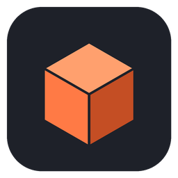
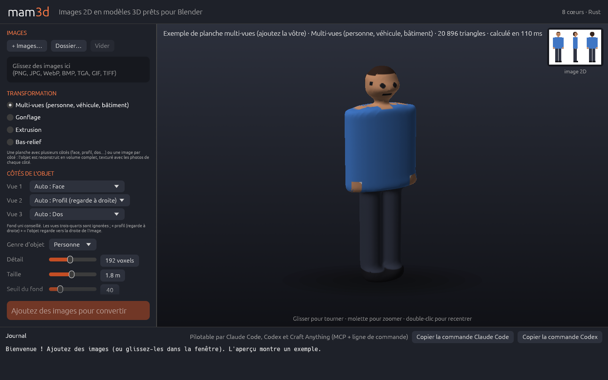
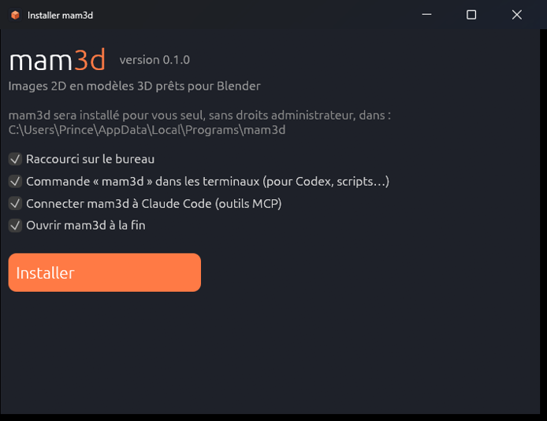
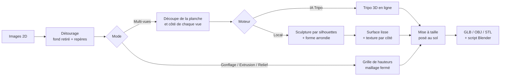
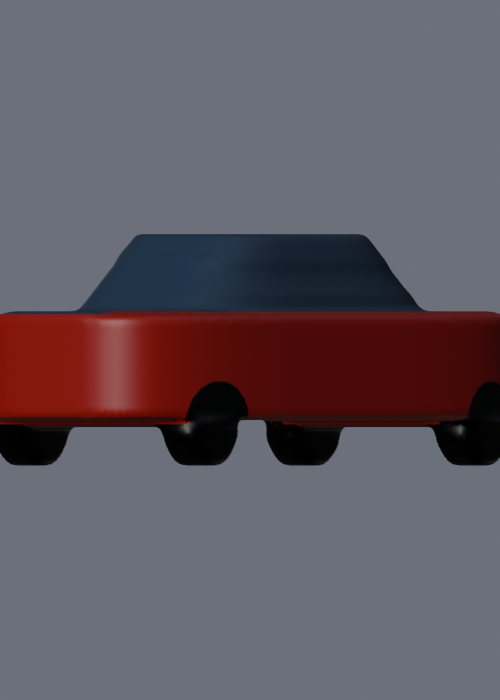

<div align="center">



# mam3d

**Transformez vos images 2D en modèles 3D prêts pour Blender, en quelques secondes.**

Personnes, véhicules, bâtiments, logos, photos : une planche multi-vues, une photo ou un
dossier entier deviennent des modèles **GLB, OBJ ou STL** texturés, fermés et à la bonne taille.
Rapide (Rust, tous les cœurs du processeur), léger (un seul programme de 12 Mo) et pilotable
par **Claude Code, Codex et Craft Anything**.


[**⬇ Télécharger l'installateur**](../../releases/latest) · [Démarrage rapide](#-démarrage-rapide) · [Comment ça marche](#-comment-ça-marche) · [Pilotage par IA](#-pilotage-par-claude-code-codex-et-craft-anything)



</div>

---

## Sommaire

1. [Ce que fait mam3d](#-ce-que-fait-mam3d)
2. [Démarrage rapide](#-démarrage-rapide)
3. [Comment ça marche](#-comment-ça-marche)
   - [Multi-vues : un objet complet à partir de plusieurs côtés](#1-multi-vues--un-objet-complet-à-partir-de-plusieurs-côtés)
   - [Personne : le dos créé automatiquement](#2-personne--le-dos-créé-automatiquement)
   - [Détourage intelligent avec repères](#3-détourage-intelligent-avec-repères-broches)
   - [Moteur IA en ligne Tripo 3D](#4-moteur-ia-en-ligne-tripo-3d-optionnel)
   - [Les transformations « une image = un modèle »](#5-les-transformations--une-image--un-modèle-)
   - [Export pour Blender](#6-export-pour-blender)
4. [Pilotage par Claude Code, Codex et Craft Anything](#-pilotage-par-claude-code-codex-et-craft-anything)
5. [Ligne de commande](#-ligne-de-commande)
6. [Compiler depuis les sources](#-compiler-depuis-les-sources)
7. [Organisation du code](#-organisation-du-code)
8. [Limites connues et pistes](#-limites-connues-et-pistes)

---

## ✨ Ce que fait mam3d

| | |
|---|---|
| 🧍 **Multi-vues** | Une planche (face, profil, dos… côte à côte) ou une image par côté : l'objet est reconstruit **en volume complet**, texturé avec la photo de chaque côté. |
| 🚗 **Genres d'objets** | Personne, animal, voiture / moto, bâtiment : la forme est arrondie (ou laissée droite) selon le genre. |
| 👤 **Dos automatique** | Une seule photo de face d'une personne ? mam3d fabrique le dos : cheveux derrière la tête, pas de visage. |
| ✂️ **Détourage** | Fond uni ou dégradé de studio retiré automatiquement, corrigeable avec des **repères verts (garder) et rouges (retirer)**. |
| 🤖 **IA Tripo 3D** *(option)* | Envoie les vues à l'IA en ligne Tripo pour un modèle bien plus détaillé (payant sur votre compte Tripo). |
| 🎈 **Gonflage, extrusion, bas-relief** | Une image = un modèle : forme gonflée, pièce épaisse ou relief de luminosité. |
| ⚡ **En lot, en parallèle** | Des dizaines d'images converties en même temps sur tous les cœurs. |
| 🟧 **Prêt pour Blender** | GLB (texture incluse), OBJ + MTL + PNG, STL ; modèles fermés, en mètres, debout, + un script qui importe tout d'un coup. |
| 🔌 **Pilotable** | Serveur **MCP** (Claude Code, Codex, Craft Anything…) et ligne de commande avec sortie JSON. |

---

## 🚀 Démarrage rapide

### Installer (Windows)

1. Téléchargez **`mam3d-setup.exe`** dans les [Releases](../../releases/latest).
2. Double-cliquez dessus : pas besoin de droits administrateur.
3. Cochez ce que vous voulez, puis **Installer**.



| Option | Effet |
|---|---|
| Raccourci sur le bureau | Ouvre mam3d d'un double-clic. |
| Commande « mam3d » dans les terminaux | Ajoute le dossier au `PATH` : Codex et vos scripts peuvent lancer `mam3d`. |
| Connecter mam3d à Claude Code | Enregistre le serveur MCP (`claude mcp add mam3d …`) si Claude Code est installé. |

mam3d s'installe dans `%LOCALAPPDATA%\Programs\mam3d`, apparaît dans le menu Démarrer et dans
*Paramètres > Applications*, d'où on le désinstalle proprement.

> **Windows SmartScreen** peut avertir au premier lancement, car le programme n'est pas signé :
> cliquez sur « Informations complémentaires » puis « Exécuter quand même ».

Installation silencieuse : `mam3d-setup.exe /S` (options `/nodesktop`, `/nopath`, `/noclaude`).
Sans installation : `mam3d-portable.exe`, à lancer tel quel.

### Premier modèle en 30 secondes

1. Ouvrez mam3d : il démarre en mode **Multi-vues** avec un personnage d'exemple.
2. Glissez votre planche (ou vos photos de face / profil / dos) dans la fenêtre.
3. Vérifiez les côtés devinés dans **Côtés de l'objet**, choisissez le **genre d'objet**.
4. Cliquez sur **Reconstruire l'objet en 3D**.
5. Dans Blender : *Fichier > Importer > glTF 2.0*, ou exécutez `importer_dans_blender.py`.

---

## 🧠 Comment ça marche



### 1. Multi-vues : un objet complet à partir de plusieurs côtés

**Ce que vous donnez :** une **planche** (plusieurs vues côte à côte sur un fond uni, comme une
fiche de personnage) ou **une image par côté**.

**Étape 1 — Découpe et côtés.** Sur une planche, mam3d repère les colonnes vides qui séparent
les vues. Il devine ensuite le côté de chacune d'après la forme de sa silhouette :

| Silhouette par rapport à la 1ʳᵉ vue | Côté deviné |
|---|---|
| la première vue | **Face** |
| bien plus étroite (ou bien plus large, pour un véhicule) | **Profil** |
| même largeur | **Dos** |
| entre les deux (trois-quarts) | **Ignorée** : son angle exact est inconnu |

Chaque côté se corrige à la main : *Face, Profil (regarde à droite), Dos, Profil (regarde à
gauche), Dessus, Ignorer*. « Regarde à droite » veut dire que l'objet regarde vers la droite
de l'image.

**Étape 2 — Sculpture.** mam3d remplit un bloc de petits cubes (voxels) puis enlève tout ce
qui tombe en dehors de la silhouette de **chaque** vue : c'est l'*enveloppe visuelle*. La face
donne la largeur, le profil la profondeur, le dessus l'emprise au sol.

**Étape 3 — Forme arrondie.** Une silhouette ne dit pas si un objet est rond ou carré. Le
**genre d'objet** le précise :

| Genre | Section de l'objet | Pour |
|---|---|---|
| Personne | ellipse ; bras et jambes pas plus épais que larges ; dos créé si absent | personnes |
| Animal / personnage arrondi | ellipse | animaux, mascottes, figurines |
| Voiture / moto / objet | « super-ellipse » : arrondie mais carrée | véhicules, objets |
| Bâtiment / meuble | droite, sans arrondi | architecture, meubles |

**Étape 4 — Surface et texture.** La surface est extraite (*surface nets*), lissée sans la faire
maigrir (*lissage de Taubin*), puis chaque triangle prend la couleur de **la photo qui le voit
le mieux**, en vérifiant qu'aucune autre partie ne le cache (un bras devant le torse, par
exemple). Les couleurs sont débordées au-delà des contours pour éviter tout liseré blanc. Le
modèle est enfin posé au sol, centré, à la taille demandée (1,8 m par défaut).

### 2. Personne : le dos créé automatiquement

Avec une seule photo de face, une reconstruction naïve affiche… le visage aussi derrière la
tête. Avec le genre **Personne**, mam3d fabrique une vue de dos à partir de la face :

- l'image est retournée gauche-droite, comme vue de derrière ;
- la tête, jusqu'au cou (repéré comme la ligne la plus étroite sous la tête), prend la
  **couleur des cheveux** prélevée en haut du crâne : plus de visage ;
- les vêtements sont adoucis : boutons, poches et cravate disparaissent, les couleurs restent.

Une vraie photo de dos donne bien sûr un résultat exact ; dès qu'elle est fournie, elle
remplace le dos créé.

### 3. Détourage intelligent avec repères (broches)

Le fond est retiré **automatiquement** à chaque conversion :

- s'il est **transparent**, la transparence est utilisée ;
- sinon, mam3d part du bord de l'image et avance de proche en proche tant que la couleur
  reste celle du fond. La couleur de référence **suit le fond** : un dégradé de studio, un
  vignettage ou une ombre douce sont retirés, alors que le saut de couleur au bord de la
  personne l'arrête. Une chemise blanche *à l'intérieur* de la silhouette reste donc.

Le bouton **Détourer…** ouvre l'atelier :

- le fond retiré est teinté de **rouge**, le contour est en **jaune** ;
- un clic ou un trait **vert (Garder)** ramène une partie perdue (un gant blanc, des cheveux) ;
- un clic ou un trait **rouge (Retirer)** enlève un reste (une ombre au sol, un objet tenu) ;
- chaque repère fait changer de côté **toute la zone de couleur semblable** autour du point,
  sans déborder sur une partie voisine de teinte proche ;
- le contour final est **calé sur les vrais bords** de l'image : une fine bande incertaine est
  partagée entre objet et fond par une *ligne de partage des eaux*. Chaque pixel y rejoint le
  côté dont il est le plus proche en couleur.

**Appliquer et enregistrer** écrit un PNG transparent `<nom>_sans_fond.png` et le met dans la
liste à la place de l'original. **Tout détourer (auto)** traite toutes les images d'un coup.

### 4. Moteur IA en ligne Tripo 3D (optionnel)

Le moteur **local** est gratuit, hors ligne et instantané, mais il ne voit que les
silhouettes : les creux (orbites, intérieur d'une voiture) restent pleins. Le moteur
**IA Tripo 3D** ([platform.tripo3d.ai](https://platform.tripo3d.ai)) invente les parties
cachées avec son IA :

1. mam3d découpe et détoure les vues ;
2. il les envoie à Tripo : une vue passe par *image vers 3D*, plusieurs par *multi-vues*
   (face / gauche / dos / droite) ;
3. il attend le résultat (1 à 3 minutes) en affichant l'avancement ;
4. il télécharge le modèle, le met à la taille voulue, l'affiche dans l'aperçu et l'exporte au
   format choisi (`<nom>_ia.glb/.obj/.stl`). Le fichier d'origine de l'IA, avec tous ses
   matériaux, est gardé à côté (`<nom>_ia_tripo_original.glb`).

| Réglage | Choix |
|---|---|
| Modèle IA | **H3.1** (détail maximal) ou **P2** (maillage léger en quadrilatères, pour les jeux) |
| Faces | automatique, ou un nombre précis |
| Texture | standard ou détaillée (plus chère) |
| Matériaux | PBR (métal, rugosité) ou simples |

**Coût :** environ 0,20 à 0,30 $ par modèle, sur **votre** compte Tripo. **La clé** (créée sur
platform.tripo3d.ai, rubrique *API Keys*) s'enregistre dans la fenêtre (*Moteur > IA Tripo 3D*),
avec `mam3d tripo-key tsk_…`, ou dans la variable `TRIPO_API_KEY`. Elle reste sur votre
ordinateur et n'est jamais affichée.

### 5. Les transformations « une image = un modèle »

| Mode | Idéal pour | Principe |
|---|---|---|
| 🎈 **Gonflage** | dessins, personnages, objets | La silhouette est gonflée comme un coussin : la hauteur suit la racine de la distance au bord. Le dos peut être plat (à poser contre un mur) ou symétrique. |
| 🧱 **Extrusion** | logos, icônes, sprites | La silhouette devient une pièce épaisse, aux bords droits. |
| 🏔 **Bas-relief** | photos, cartes de hauteur, terrains | Le clair devient haut (ou l'inverse), sur une plaque d'épaisseur réglable. |

Le contour est adouci pour effacer les marches d'escalier des pixels. Chaque modèle est
**fermé** (sans trou), donc aussi imprimable en 3D.

### 6. Export pour Blender

| Format | Contenu | Dans Blender |
|---|---|---|
| **GLB** *(conseillé)* | maillage + normales + texture intégrée | *Fichier > Importer > glTF 2.0* |
| **OBJ** | `.obj` + `.mtl` + `_texture.png` | *Fichier > Importer > Wavefront (.obj)* |
| **STL** | maillage seul (impression 3D) | *Fichier > Importer > STL* |

- les modèles arrivent **debout**, face à la vue de face (pavé numérique 1), **en mètres** ;
- chaque conversion écrit `importer_dans_blender.py` : dans Blender, onglet *Scripting* >
  *Ouvrir* > *Exécuter* importe tous les modèles d'un coup, rangés côte à côte ;
- vérifié avec Blender 5.3 : modèles fermés (aucune arête ouverte), texture présente, bonne
  orientation.



*Une voiture reconstruite à partir d'une vue de face et d'un profil, rendue dans Blender.*

---

## 🔌 Pilotage par Claude Code, Codex et Craft Anything

mam3d est un **serveur MCP** (*Model Context Protocol*) : un assistant IA peut l'utiliser comme
un outil.

```bash
# Claude Code (l'installateur peut le faire pour vous)
claude mcp add mam3d -- "%LOCALAPPDATA%\Programs\mam3d\mam3d.exe" mcp
```

```toml
# Codex : ~/.codex/config.toml
[mcp_servers.mam3d]
command = 'C:\Users\<vous>\AppData\Local\Programs\mam3d\mam3d.exe'
args = ["mcp"]
```

Craft Anything : outil `plugins_add` avec l'id `mam3d`, la commande `mam3d.exe` et les arguments
`["mcp"]`, puis `plugins_refresh`. Dans la fenêtre de mam3d, les boutons **Copier la commande
Claude Code / Codex** copient la bonne ligne avec le bon chemin.

| Outil MCP | Ce qu'il fait |
|---|---|
| `reconstruct_multiview` | Un objet complet à partir d'une planche ou d'une image par côté (moteur local ou Tripo, genre d'objet, côtés). |
| `convert_images` | Convertit une ou plusieurs images (ou dossiers) en parallèle, dans n'importe quel mode. |
| `remove_background` | Détoure des photos, avec repères `keep_points` / `remove_points` en option. |
| `inspect_image` | Taille, transparence, part de l'image occupée par l'objet, mode conseillé. |
| `list_modes` | Modes, formats et réglages par défaut. |

Chaque outil renvoie un compte rendu JSON : fichiers écrits, nombre de triangles, taille en
mètres, temps de calcul, côté attribué à chaque vue.

> Le moteur `tripo` dépense des crédits : la description de l'outil demande aux assistants de
> ne l'utiliser que si vous l'avez demandé.

---

## ⌨️ Ligne de commande

```bash
mam3d                                   # ouvre la fenêtre
mam3d photo1.png photo2.png             # ouvre la fenêtre avec ces images

# Multi-vues : un objet complet
mam3d multiview planche.png -s 1.8
mam3d multiview face.png profil.png dos.png --angles front,side_right,back
mam3d multiview voiture.png --shape vehicle -s 4.5 -f obj
mam3d multiview planche.png -e tripo --ai-model h3.1 --faces 30000

# Une image = un modèle, en lot
mam3d convert photos/ -o sortie -m inflate -f glb --json
mam3d convert logo.png -m extrude --depth 0.1
mam3d convert terrain.png -m relief --depth 0.5 -f stl -r 512

# Détourage
mam3d remove-bg photo.png
mam3d remove-bg photo.png --remove 512,980 --keep 300,420 --radius 8

# Divers
mam3d inspect image.png                 # conseille un mode
mam3d modes --json                      # modes, formats, réglages
mam3d tripo-key tsk_xxx                 # enregistre la clé Tripo (--forget pour l'oublier)
mam3d mcp                               # serveur MCP (stdin/stdout)
mam3d --screenshot capture.png          # capture de la fenêtre puis quitte
```

<details>
<summary><b>Toutes les options de <code>convert</code> et <code>multiview</code></b></summary>

| Option | Sens | Défaut |
|---|---|---|
| `-m, --mode` | `inflate`, `extrude`, `relief`, `multiview` | `inflate` |
| `-f, --format` | `glb`, `obj`, `stl` | `glb` |
| `-r, --resolution` | détail (cellules ou voxels sur le plus grand côté) | 256 / 192 |
| `-d, --depth` | épaisseur ou hauteur (m) | 0.3 |
| `-s, --size` | plus grande dimension (m) | 2 / 1.8 |
| `--background` | `auto`, `alpha`, `color`, `none` | `auto` |
| `--threshold` | écart de couleur objet / fond | 40 |
| `--invert` | inverser clair / sombre | non |
| `--back-scale` | gonflage : épaisseur du dos (0 = plat) | 1 |
| `--shape` | `person`, `organic`, `vehicle`, `building` | `person` |
| `-a, --angles` | côtés : `auto`, `front`, `side_right`, `back`, `side_left`, `top`, `ignore` | auto |
| `-e, --engine` | `local` ou `tripo` | `local` |
| `-j, --threads` | nombre de fils de calcul | tous les cœurs |
| `--json` | compte rendu JSON | non |
| `--no-blender-script` | ne pas écrire le script Blender | non |

Codes de sortie : `0` tout a réussi, `1` au moins un échec, `2` aucune image.
</details>

---

## 🛠 Compiler depuis les sources

Il faut [Rust](https://rustup.rs) (édition 2024) ; sous Windows, les outils de compilation C++ de
Visual Studio.

```bash
git clone https://github.com/princebilogocode/mam3d.git
cd mam3d
cargo build --release        # target/release/mam3d.exe
cargo test --release         # vérifie maillages fermés, détourage, lecture GLB, planches
```

Pour refaire l'installateur Windows (`dist/mam3d-setup.exe`, `dist/mam3d-portable.exe`) :

```powershell
powershell -ExecutionPolicy Bypass -File make_installer.ps1
```

L'installateur est un petit programme Rust (`installer/`) qui embarque le `mam3d.exe`
fraîchement construit : un seul fichier, sans outil d'installation externe.

---

## 🗂 Organisation du code

```
mam3d/
├── src/
│   ├── main.rs        # ligne de commande, lancement de la fenêtre
│   ├── gui.rs         # fenêtre egui : liste, réglages, aperçu 3D, atelier de détourage
│   ├── multiview.rs   # planches, côtés, sculpture, surface nets, texture par côté, dos créé
│   ├── cutout.rs      # détourage : fond relié au bord, repères, ligne de partage des eaux
│   ├── mesh.rs        # gonflage, extrusion, bas-relief
│   ├── export.rs      # écriture GLB, OBJ + MTL + PNG, STL
│   ├── glb.rs         # lecture de GLB (résultats de l'IA)
│   ├── tripo.rs       # moteur IA en ligne Tripo 3D
│   ├── convert.rs     # conversions en lot (rayon), script Blender
│   ├── mcp.rs         # serveur MCP pour les assistants
│   └── settings.rs    # réglages partagés (fenêtre, ligne de commande, MCP)
├── installer/         # installateur Windows (mam3d-setup.exe)
├── assets/            # icône
├── docs/              # images de ce README
└── make_installer.ps1
```

Bibliothèques principales : [eframe/egui](https://github.com/emilk/egui) (fenêtre),
[image](https://github.com/image-rs/image), [rayon](https://github.com/rayon-rs/rayon)
(parallélisme), [clap](https://github.com/clap-rs/clap), [ureq](https://github.com/algesten/ureq),
[rfd](https://github.com/PolyMeilex/rfd).

---

## 🚧 Limites connues et pistes

- **Moteur local :** seules les formes visibles sur les silhouettes sont reconstruites ; les
  creux (orbites, intérieur d'un habitacle, balcons en retrait) restent pleins et ne sont
  rendus que par la texture. Des bandes horizontales légères et des raccords de couleur entre
  les vues peuvent se voir.
- **Une seule vue de face :** la profondeur est estimée, et une marche peut apparaître au niveau
  des aisselles.
- **Détourage automatique :** pensé pour les fonds unis ou dégradés ; un décor chargé (rue,
  salon) demande des repères ou une photo sur fond uni.
- **Tripo 3D :** la communication avec le service a été vérifiée, mais pas encore une
  génération complète de bout en bout ; le sens gauche / droite des profils envoyés reste à
  confirmer au premier vrai essai.
- **Windows d'abord :** le code est multiplateforme, mais l'installateur et les tests visent
  Windows 10 / 11.

Pistes : estimation de profondeur par IA hors ligne pour les visages, mélange des textures entre
vues, réduction du nombre de faces, animation et squelette automatiques.

---

<div align="center">

Licence [MIT](LICENSE) · Fait avec 🦀 Rust · Contributions bienvenues

</div>
